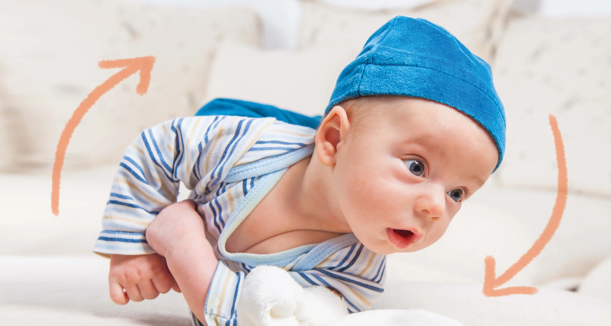
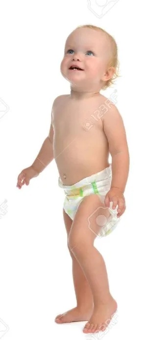
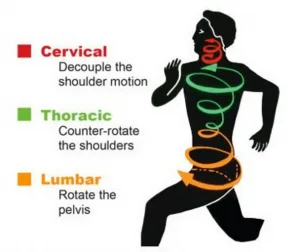
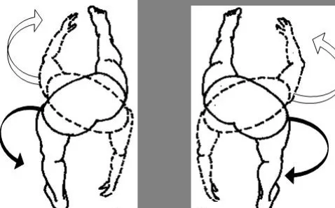
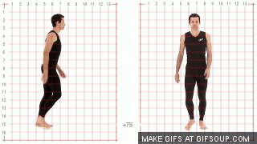

<h2 id="principles-of-practice">Principles of Practice</h2>

We choose treatment based on your condition and circumstances.

### Start with the lowest effective risk

We start with the lowest-risk option that can address the problem.

### Help patients take an active role

We teach self-treatment techniques so you can take an active role in your recovery. The term *internal locus of control* describes the sense that your actions can influence your progress.

### Address the contributors to the problem

Injury, mechanical stress, muscle imbalance, tissue health and lifestyle can all inform our assessment. Where possible, we address the factors that contribute to the problem.

### Chiropractic as a practice

Our practice brings together the skill of applying a technique, the study of whether its results can be examined and reproduced, and a philosophy of working with the body’s capacity for healing.

<h2 id="expansion-method">The Expansion Method</h2>

Scott developed the Expansion Method over 35 years of practice. It focuses on how the body alternates between expanding and contracting during movement. Treatment uses mobilization to encourage opening, coordinated contraction, and the storage and release of energy.

### How movement develops

#### Rolling and crawling

An infant progresses from the fetal position to lengthening, turning and rolling. The head, arms and legs begin to work with the trunk. Crawling adds a pattern in which opposite sides of the body work together.

#### Sitting and standing

Sitting and standing require the body to lengthen against gravity. As an infant learns to sit, the chin retracts and the upper back flattens. Standing adds coordination between the upper and lower body. A child initially uses support and gradually learns to balance upright independently.

#### Walking

During gait, the head, chest, pelvis and feet rotate in opposing directions around the body’s vertical axis. In the Expansion Method, the step forward illustrates expansion. The transition from heel strike to mid-stance illustrates the return toward contraction.

<figure>
  <picture>
    <source media="(prefers-reduced-motion: reduce)" srcset="/assets/images/walking-still.webp">
    
  </picture>
  <figcaption>Counter-rotation during walking.</figcaption>
</figure>

### Treatment and movement goals

The Expansion Method uses standing and walking as models for three movement goals:

1. Lengthen the spine against gravity and store and release elastic energy.
2. Rotate outward around the vertical axis without restriction.
3. Return from expansion with a controlled contraction.

Treatment uses gentle, oscillating mobilization around joints and connective tissue. In one position, the patient sits with the legs extended while we work along the spine from the tailbone to the base of the skull through extension, rotation and side bending.

The method is based on the theory that mobilizing restricted tissue and stimulating sensory receptors can produce muscular reflex responses that continue to influence movement beyond the treatment session, potentially for several days.
