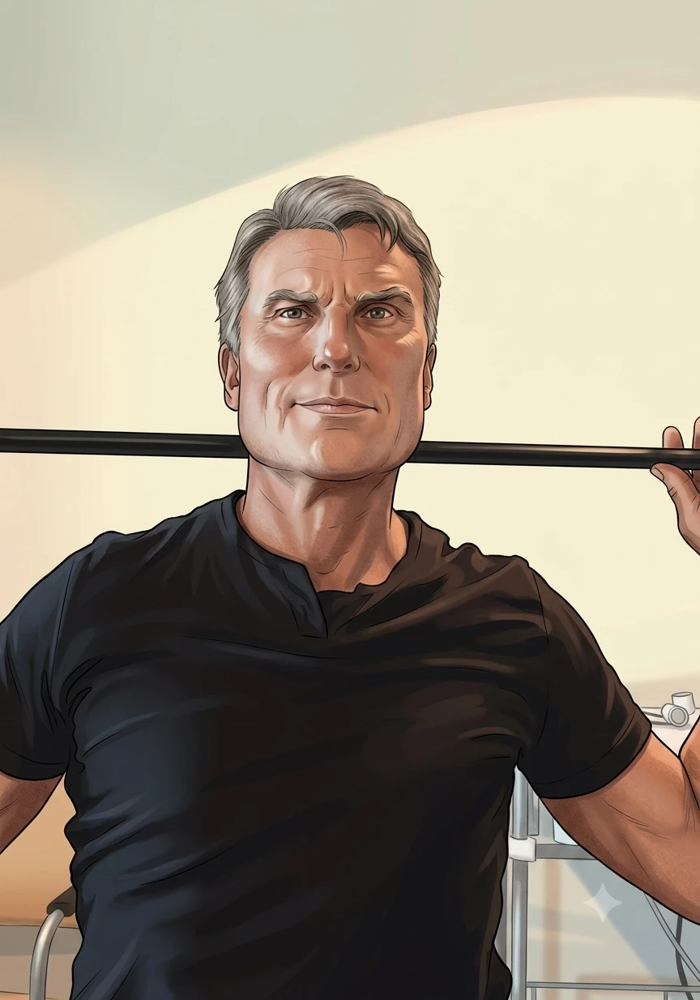
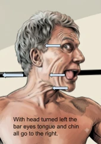
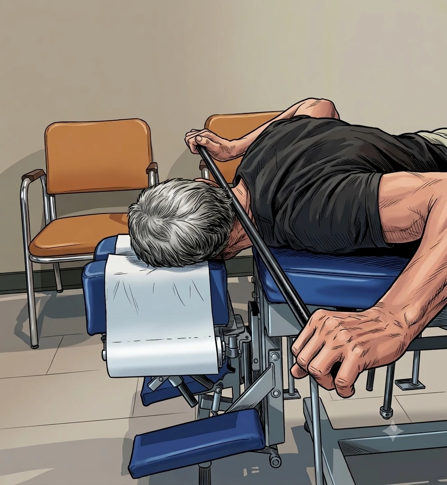
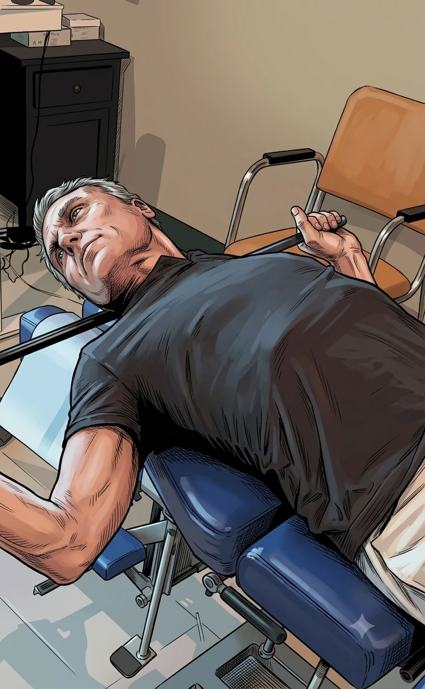
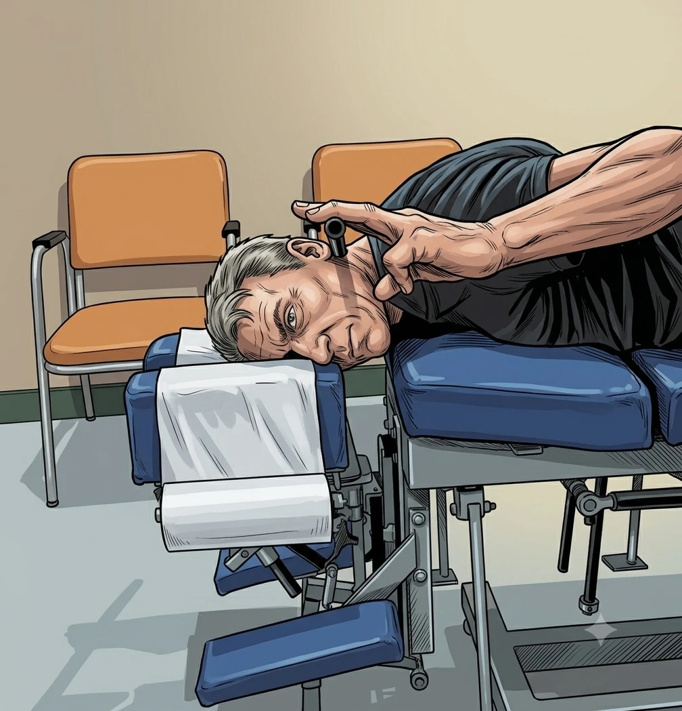
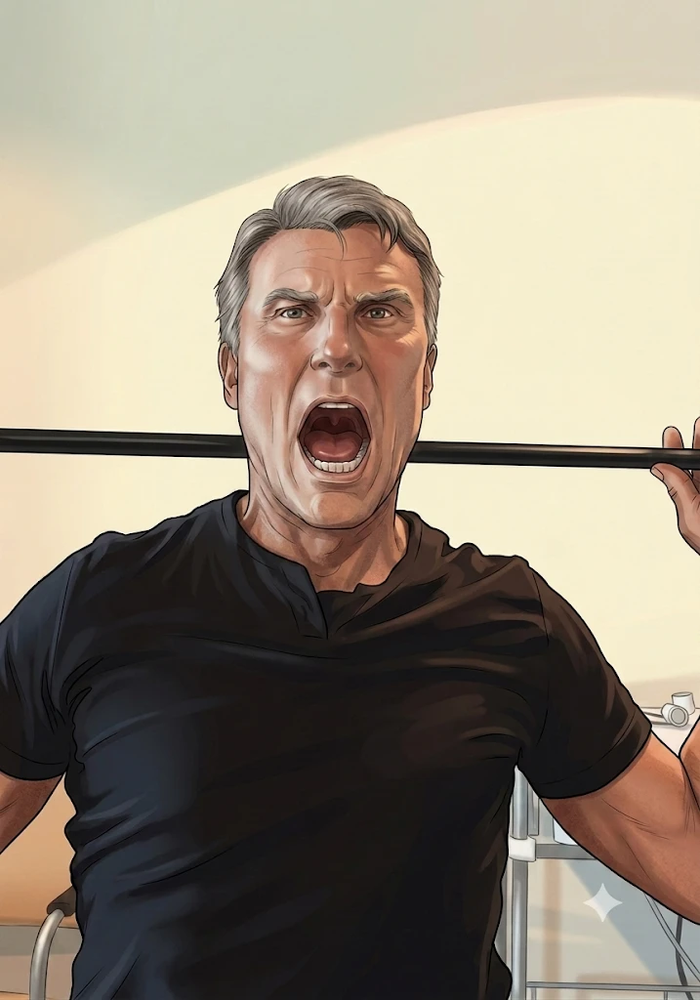

Because modern life lacks proper, diverse movement, the suboccipital muscles and myodural bridge chronically tighten. To rehabilitate this area naturally, we must guide these tissues into precise, end-range expansion using the following specialized mobilization protocol:

<h2>Step 1: Select and position the tool</h2>

Acquire a 1/2-inch metal pipe, approximately 4 inches long.

Place the pipe right at the suboccipital junction (where the base of your skull meets your neck).

Note: This can be performed while sitting, lying on your back, or lying face down.

Step1: Place the bar at the junction of the cranium and upper cervical spine, picture Step 2: lay face down and turn head with bar in same position as step onStep 3: Slowly move the bar in the opposite direction that your head is turned and open your eyes jaw and tongue and move them in the same direction as the bar and then gently roll the bar up and down finding the tension restricted points and spending some time at that location.

<figure></figure>

<figure></figure>

<figure></figure>

<h2>Step 2: Opposite-glide rotation</h2>

Gently turn your head to one direction.

<figure></figure>

<figure></figure>

<figure></figure>

<figure></figure>

Doing this face down is the most effective but it can be done sitting laying on you back. The jaw eyes and tongue movements are always the same

<ul>

<li>Roll the pipe up and down to find the tightest, most tender muscle fibers in that suboccipital region.</li>

<li>Slide and pull the pipe in the opposite direction that your head is turned.</li>

<li>While holding pressure and pulling the pipe, open your mouth.</li>

<li>Move your jaw, your eyes, and even stick your tongue out—moving all of them in the same direction as the pull of the pipe.</li>

<li>This neurological "co-activation" tricks the brain's cranial nerves, forcing the deep, guarded neck muscles to instantly drop their defensive tone.</li>

</ul>

<h2>Step 3</h2>

Open your mouth fully and pull bar caudal or downward on the bar both in the midline and to each side to feel the stretch between your jaw opening and the neck muscles trying to get your head to tip back but resist it and pull down and roll the bar down or slide it down on your neck starting at the base of your skull.

<figure></figure>
