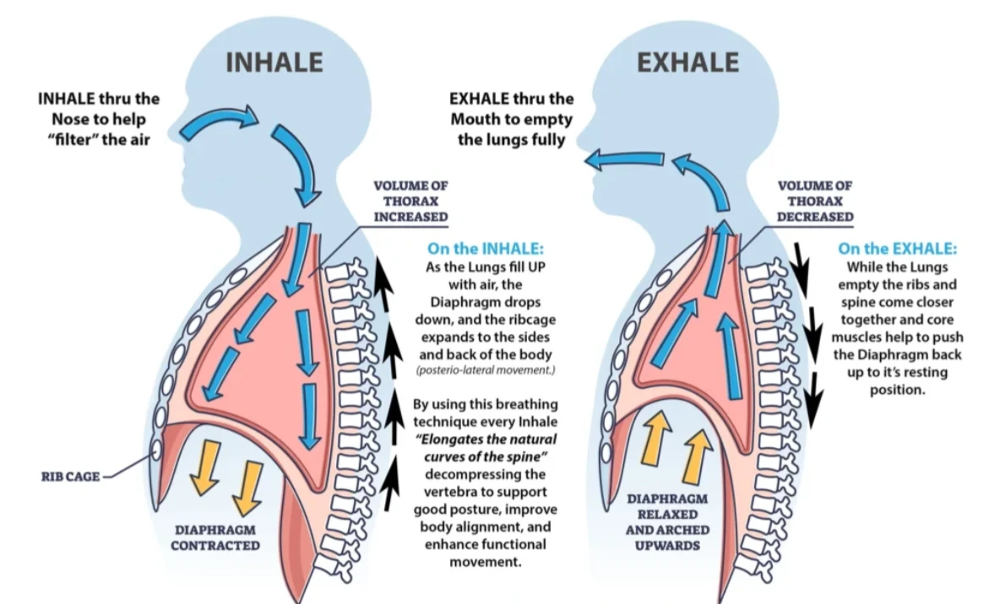
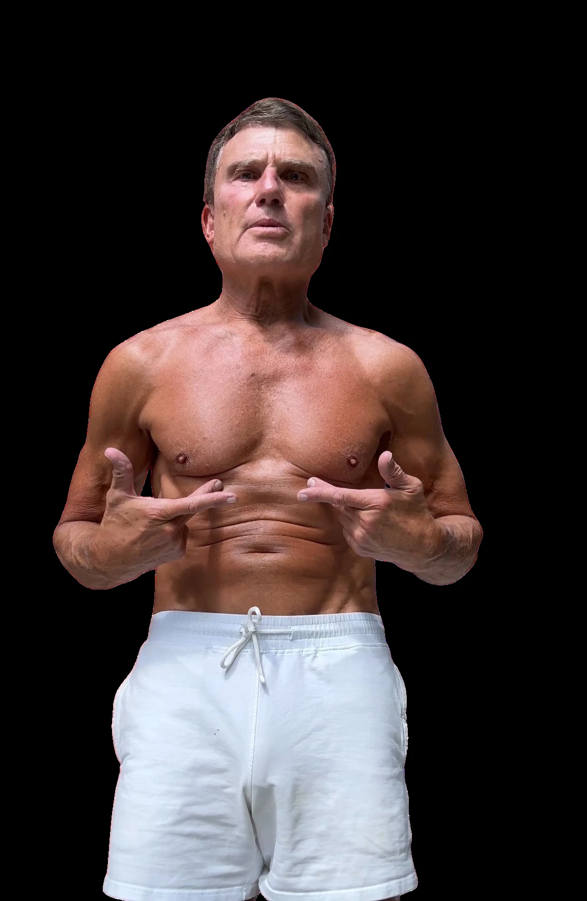
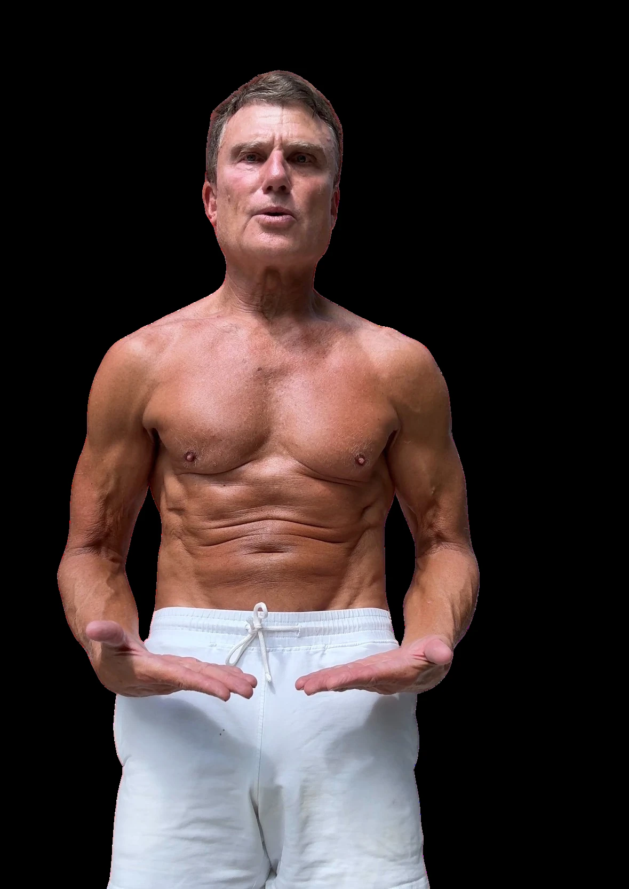

Diaphragmatic breathing is a mandatory component of every Poppkinetics mobilization, end-range drill, and corrective exercise.

Facilitating End-Range Mobility: Inhaling into the posterior diaphragm creates internal hydraulic expansion, mobilizing the ribcage and thoracolumbar fascia from within.

De-escalating Protective Guarding: Breathing shallowly or holding your breath triggers a sympathetic fight-or-flight response, causing hypertonic muscles to guard joint ranges. Diaphragmatic pacing activates the vagus nerve, downregulating nervous system tension and signaling the neuromuscular system that it is safe to access deeper end-range positions.

Dynamic Spinal Support: Exhaling smoothly during exertion or mobilization integrates deep core tension without breath-holding (Valsalva), preventing dangerous blood pressure spikes while maintaining full segmental stability.

<h2>Benefits of diaphragmatic breathing</h2>

Secretion Clearance &amp; Lung Function: Rhythmic pressure swings across the thoracic cavity help dislodge stagnant mucus from the lung bases, facilitating clearer airways—crucial during recovery or periods of reduced mobility.

Vagal Tone &amp; Stress Regulation: Slow, controlled respiration stimulates the vagus nerve, reducing heart rate, stabilizing blood pressure, and quelling sympathetic overdrive.

Pain Modulation: Chronic discomfort keeps the nervous system on high alert. Restoring natural diaphragmatic excursion helps disrupt compensatory tension cycles and reduces central sensitivity to pain.

<figure class="diagram"></figure>

<h2>Directing the breath toward the back of the diaphragm</h2>

True diaphragmatic breathing involves more than letting the belly push forward. To optimize spinal decompression and core recruitment, focus on three-dimensional, posterolateral rib expansion.

As shown in the lateral cross-section diagram above, an optimal inhale directs air downward and backward into the posterior diaphragm and lower ribcage:

Posterolateral Expansion: Rather than puffing out solely through the anterior abdomen, the ribcage expands outward to the sides and into the back of the body.

Spinal Decompression: As the diaphragm contracts downward and air fills the posterior thoracic cavity, the natural curves of the spine elongate. This decompresses the vertebrae, improves functional alignment, and provides balanced internal stability.

Complete Core Engagement: Expanding the posterior diaphragm activates the deep muscular cylinder—including the transverse abdominis and pelvic floor—from the inside out.

<h2>Chest and diaphragmatic breathing</h2>

Breathing is an essential function of the human body, but many people aren&#x27;t aware of the differences between chest and diaphragmatic breathing. Understanding these two types of breathing can help you improve your respiratory efficiency and overall well-being.

<figure></figure>

<h2>How to identify your breathing pattern</h2>

To determine whether you are using your chest or diaphragm to breathe, you can perform a simple test:

<ol>

<li>Find a Comfortable Position: Sit or lie down in a comfortable position where you can relax your body.

</li>

<li>Place Your Hands:

<ul><li>Place one hand over your sternum (the flat bone in the center of your chest).</li><li>Place the other hand over your belly, just above the navel.</li></ul>

</li>

<li>Breathe Naturally: Take a few natural breaths without trying to change your breathing pattern.

</li>

<li>Observe Your Hands:

<ul><li>Chest Breathing: If you feel the hand over your sternum rising as you inhale, you are primarily using your chest and neck muscles to breathe.</li><li>Diaphragmatic Breathing: If the hand on your belly moves outward or if you feel your ribs expanding on the sides, you are using your diaphragm.</li></ul>

</li>

</ol>

<figure></figure>

<figure></figure>

<h2>Practice diaphragmatic breathing</h2>

<figure></figure>

To cultivate diaphragmatic breathing, try the following exercise:

<ol>

<li>Lie Down: Start by lying flat on your back with your knees bent and feet flat on the floor.</li>

<li>Use Your Hands: Place one hand on your upper chest and the other on your belly.</li>

<li>Inhale Deeply: Slowly inhale through your nose, allowing your belly to rise as you fill your lungs with air.</li>

<li>Exhale Slowly: Exhale gently through your mouth, feeling your belly fall as you release the air.</li>

<li>Repeat: Practice this exercise for a few minutes each day to train your body to use your diaphragm more effectively.</li>

</ol>

