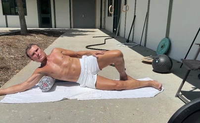
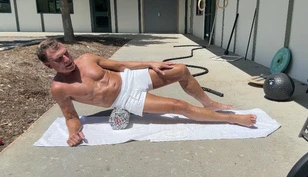

<h2>Starting position</h2>

Place the foam roller high under your armpit, right at the base of your shoulder.

<h2>Movement sequence</h2>

Upper Back &amp; Rotator Cuff: Starting near the armpit, roll gently back and forth to target the full rotator cuff and shoulder attachment area.

<figure></figure>

Mid-Back &amp; Rib Cage: Shift down along the side of your rib cage (latissimus dorsi and intercostals). Rotate your body slightly forward and backward to hunt for tight spots.

<figure></figure>

Lower Back &amp; Flank: Continue moving down toward your lower back and side trunk, exploring different angles to locate areas of tension.

<figure></figure>

Hip &amp; Upper Leg: Move all the way down to your outer hip and the upper portion of your side leg (IT band/glute medius), rolling back and forth over any tender spots..

