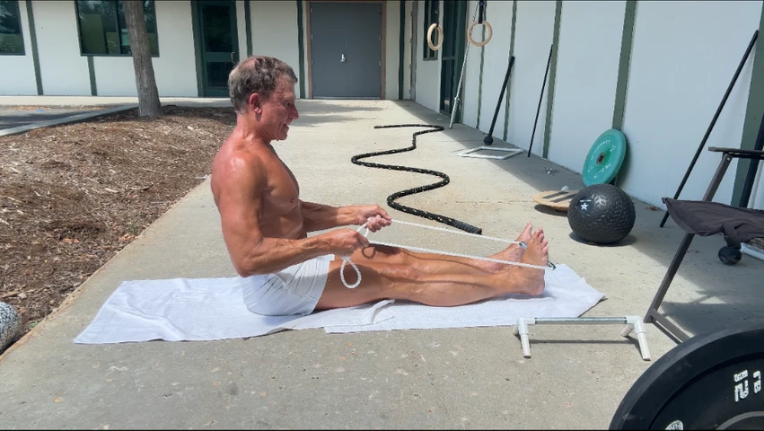
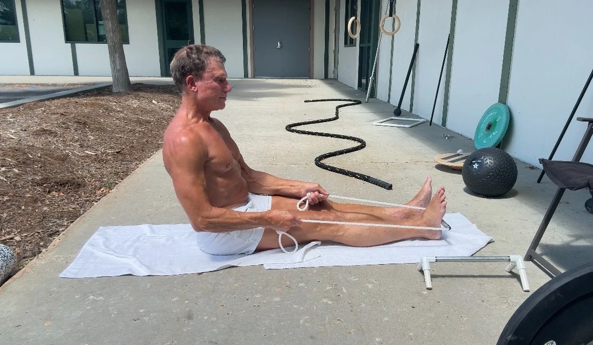

Key Cue for Alignment: Maintain a tall posture throughout this drill. Avoid rounding your spine— hinge strictly at the hips while keeping a slight arch (neutral-to-extended curve) in your lower back to maximize the tension through the posterior chain.

<figure></figure>

Seated Setup: Sit on the floor with your legs fully outstretched in front of you

Tool Placement: Position the metal pipe across the sole of your foot, starting down near the heel.

Grip Setup: Wrap the attached rope securely around your hands until you have a firm, tight grip.

Postural Frame: Sit up as straight as possible, pull the pipe taut using both arms, and hinge forward at the hips to engage the stretch.

<figure></figure>

<h2>Ascending pass (heel to forefoot)</h2>

Slowly work the pipe back and forth, migrating from the heel all the way up to the ball of the foot (just behind the first metatarsophalangeal joint).

Trigger-Point Treatment: Pausing over any tender or tight spots you encounter along the way to let the tissue release.

<figure></figure>

<h2>Calf pumps at the forefoot</h2>

Once you reach the forefoot, perform 10 to 15 calf raises (ankle pumps) against the resistance of the pipe.

<h2>Descending pass (forefoot to heel)</h2>

Slowly work the pipe back down toward the heel, again stopping to treat tender spots as you go.

<h2>Dosage and target areas</h2>

Sets/Reps: Perform 1 to 3 passes per foot.

Target Sensation: When executed with a proper hip hinge and upright posture, you will feel a deep stretch extending through the sole of the foot, calf, hamstring, and into the lower back.

