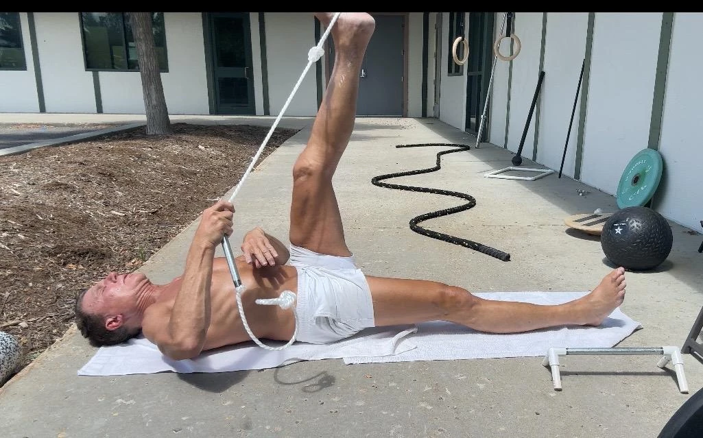
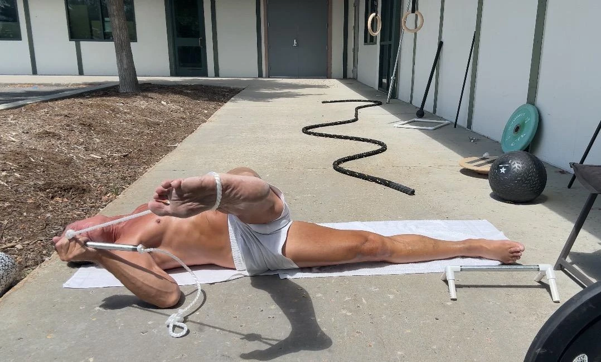
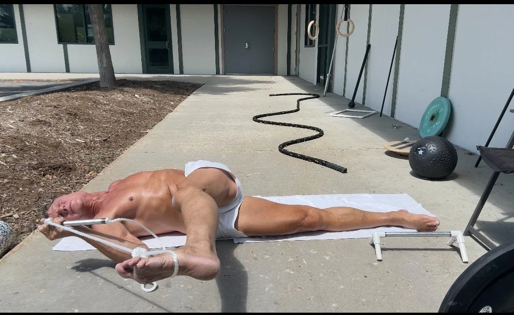
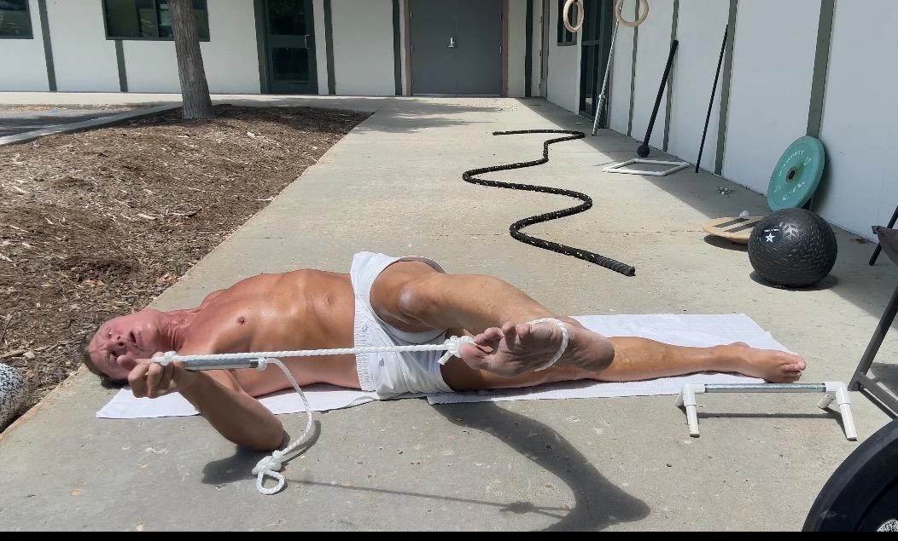

<figure></figure>

1:First raise one leg and hook the rope around the foot and keep the knee as straight as possible and lower the knee across the body as far as you can and you need to find this deep end range. At this point from the far end the leg only needs to be raised about 20° vertically. It should be very difficult and the purpose of the rope is to keep it from moving downward. The leg raise is strictly vertical. Perform 2 sets of 10 reps each leg

<figure></figure>

<figure></figure>

2:The next movement is from this fully abducted and flexed position of the leg you move the leg cuddle or down towards the other foot about 20 to 30° while you give resistance with the rope. The leg should be as far over or as close to the ground as possible for the starting position and the movement is relatively short but give yourself good resistance and it should be very difficult. perform this 10 times. 2 sets of 10 reps each side.

<figure></figure>

<figure></figure>

