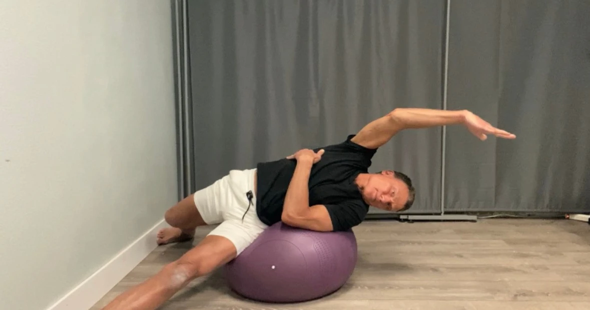
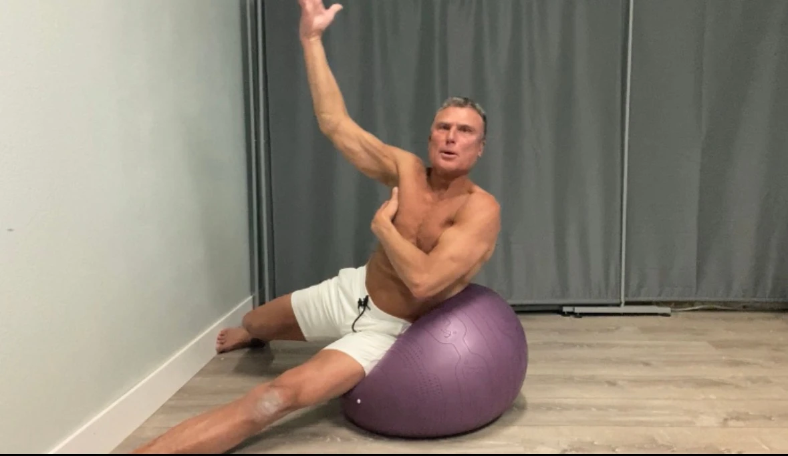
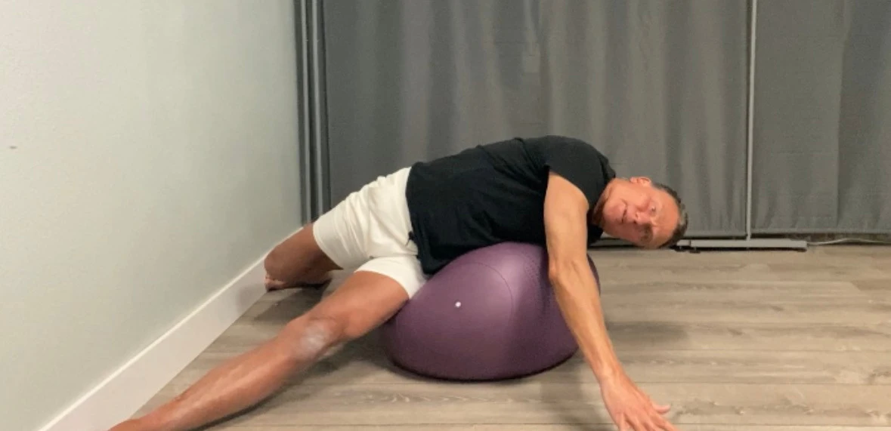
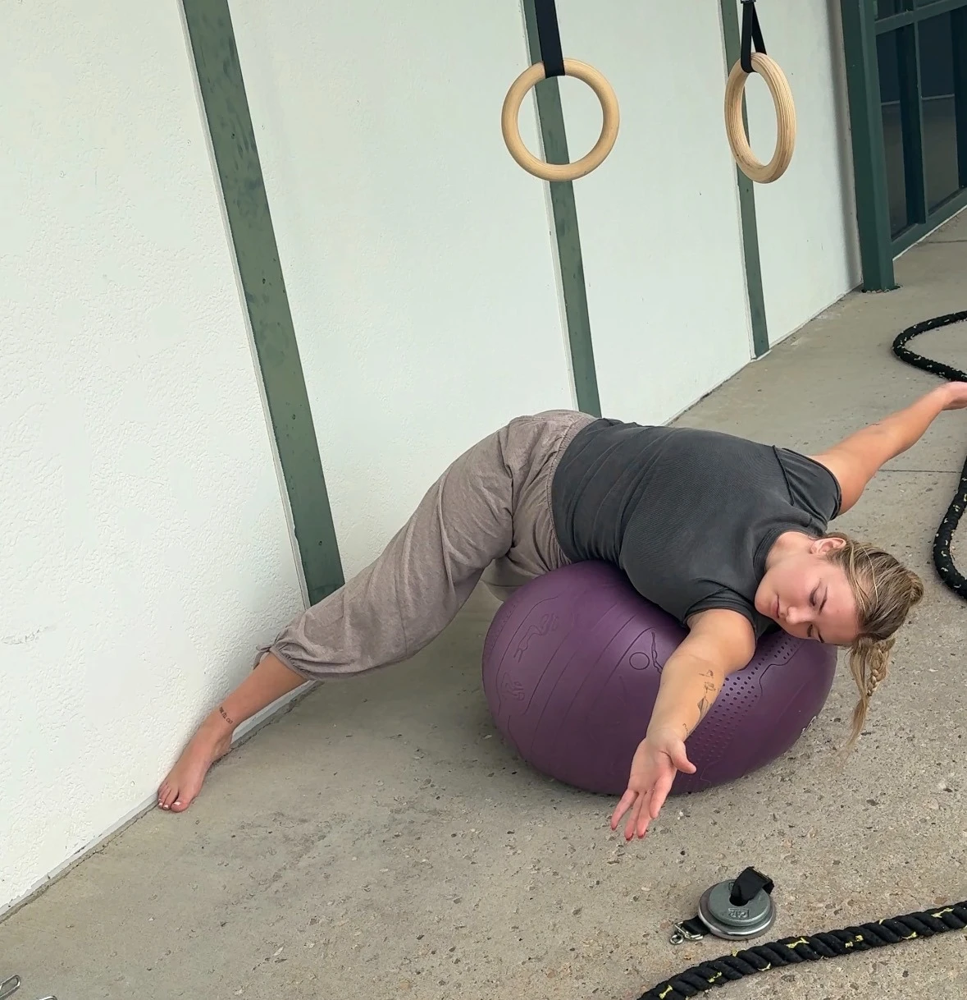

This is an amazing exercise for lower back disorders. It addresses a movement that is often lost and needs to be regained through movement to its end range.

Complete two sets of 10 reps on each side. Following every 10 reps, perform the stretch. In the two positions listed below.

<figure></figure>

1: Center yourself with your hip in the middle of the ball. Position your lower leg forward and your upper leg backward. Laterally flex your body perpendicular to the wall over the ball, with your lower hand on the ball and your upper hand vertical over your body.

<figure></figure>

2: The exercise involves a vertical movement perpendicular to the wall. You should engage your side muscles, not your abdominal muscles. Perform 10 slow, controlled repetitions. Then move on to the next image, which demonstrates a counter-rotation stretch over the ball.

<figure></figure>

3: Stretching over the ball. This is a stretch in which you move your upper arm forward, similar to the running position in gait, while your lower arm moves straight backward. Then, laterally flex your entire body over the ball. Remain in this stretched position for at least 10 seconds.

<figure></figure>

4: Reversing the stretch over the ball. On the same side, reverse your legs and upper body completely. Then stretch and laterally flex over the ball. Hold this stretch for at least 10 seconds.

