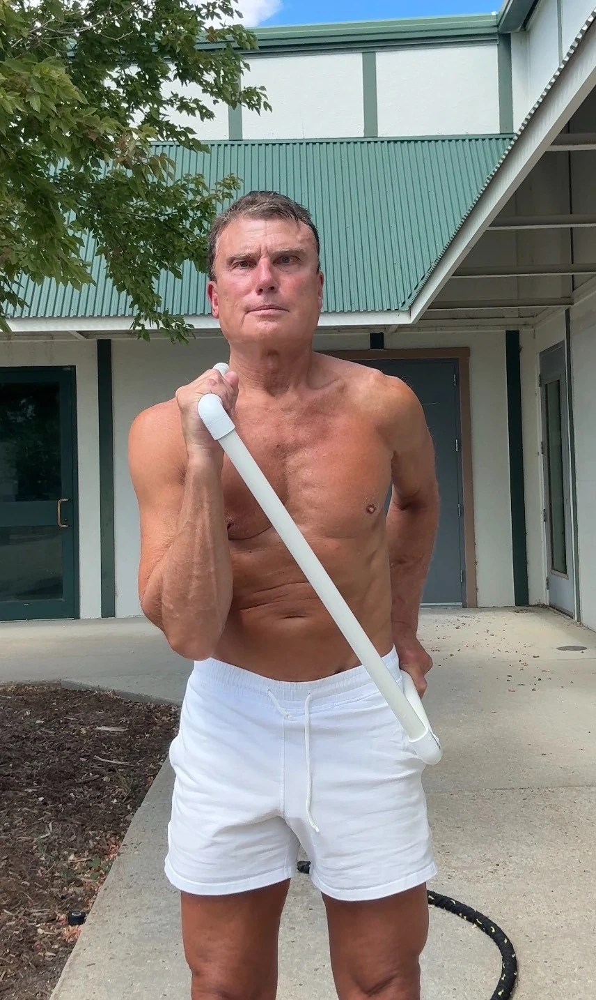
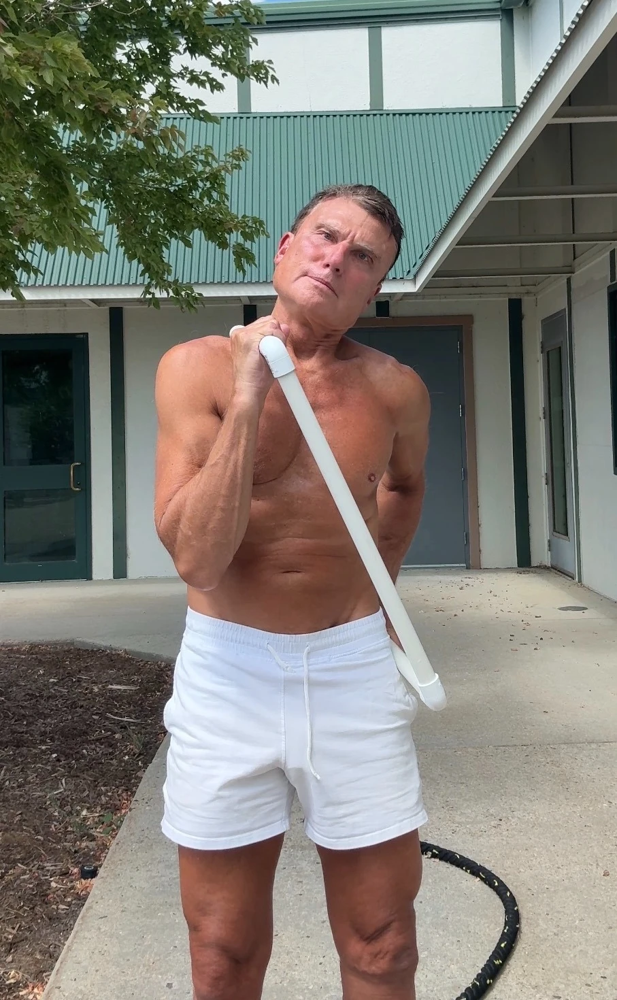
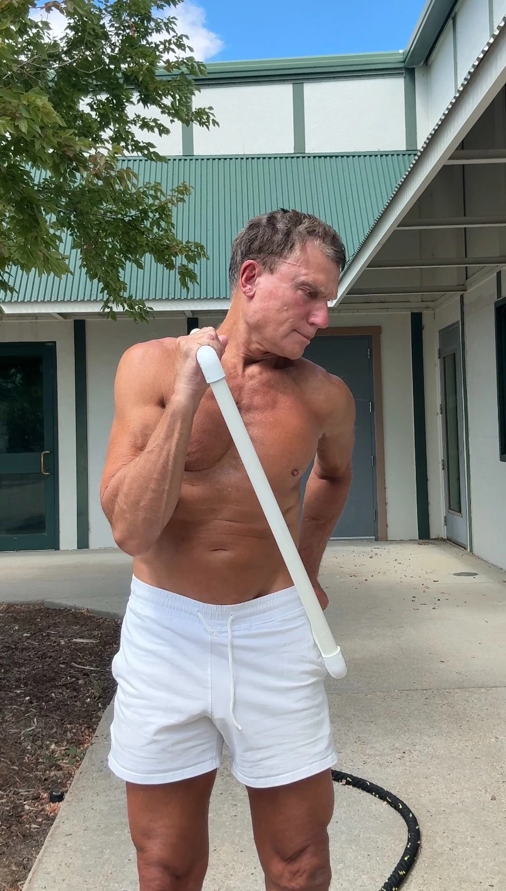
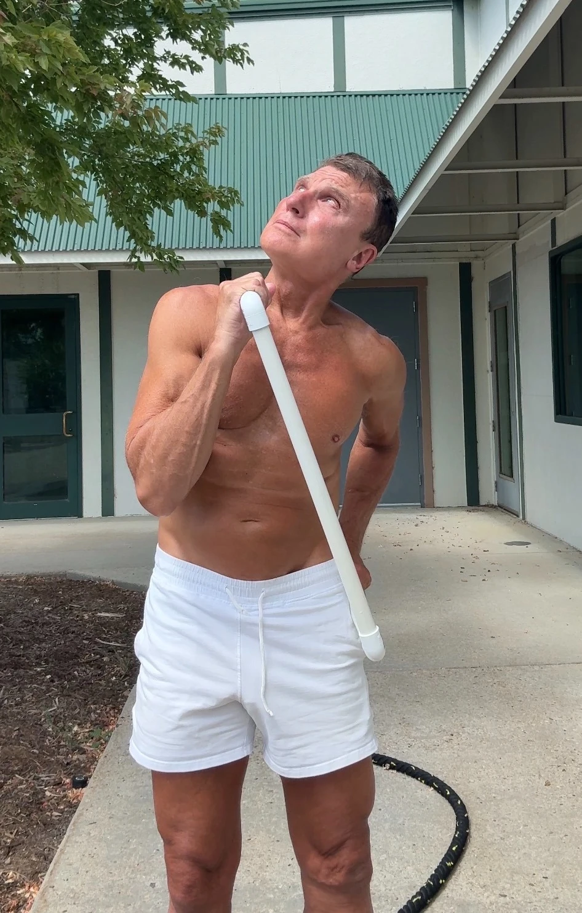

<h2>Starting position</h2>

Place the neck flosser securely in the &quot;crotch&quot; or junction where your neck meets your shoulder.

<figure></figure>

<figure></figure>

<h2>Movement sequence</h2>

Side Bend: Gently tilt (side-bend) your head away from the flosser, bringing your opposite ear toward your opposite shoulder.

<figure></figure>

<figure></figure>

Rotation: While keeping your head tilted, slowly rotate your head left and right to work into the deep tissue stretch.

Repetition: Perform this rotation several times in this position.

Progressive Placement: Shift the neck flosser slightly outward along the top of your shoulder (towards the tip of the shoulder) and repeat the tilting and rotating sequence.

Perform the full routine on both sides

