<h2>Clinical rationale for using a rope</h2>

<figure>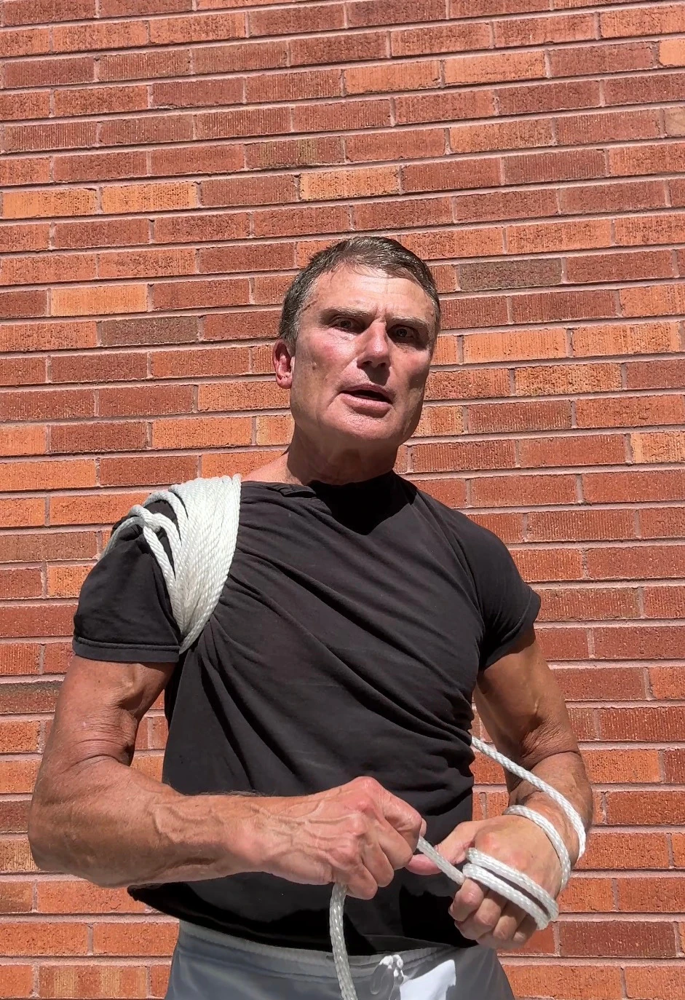</figure>

The rope adds several complementary elements to end-range shoulder exercise. Its gentle compression may support the body’s bioelectric healing response, while the stretch and controlled end-range movement encourage expansion and mobility. At the same time, the rope helps stabilize and protect the joint, reducing unwanted shear and allowing the exercise to be performed in a controlled, comfortable manner. By combining compression, stretching, active end-range loading, and joint stabilization, this approach integrates multiple therapeutic principles into one coordinated rehabilitation process.

By externally anchoring and compressing the glenohumeral joint with a soft rope wrap, you minimize excessive humeral shearing and overload. This forces true scapular retraction against the rib cage during mobilization and creates a safe, locked foundation for strengthening end-range motion without joint impingement.

<h2>The three-joint system</h2>

<figure>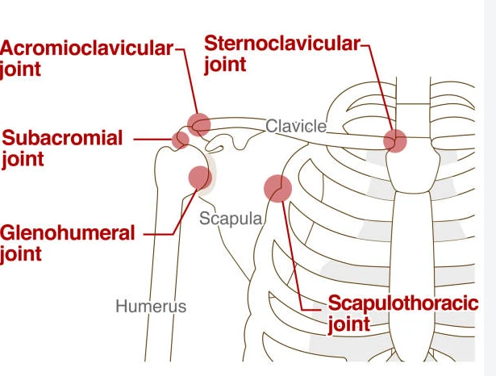</figure>

Most shoulder rehabilitation programs fail or worsen symptoms because they treat the shoulder as a single ball-and-socket joint. In reality, functional shoulder motion relies on an integrated three-joint complex:

<ol>

<li>Glenohumeral Joint: The primary outer ball- and-socket connection.</li>

<li>Scapulothoracic Articulation: The scapula gliding across the thoracic rib cage.</li>

<li>Thoracic Spine: Flexion, extension, and rotation mechanics.</li>

</ol>

<figure>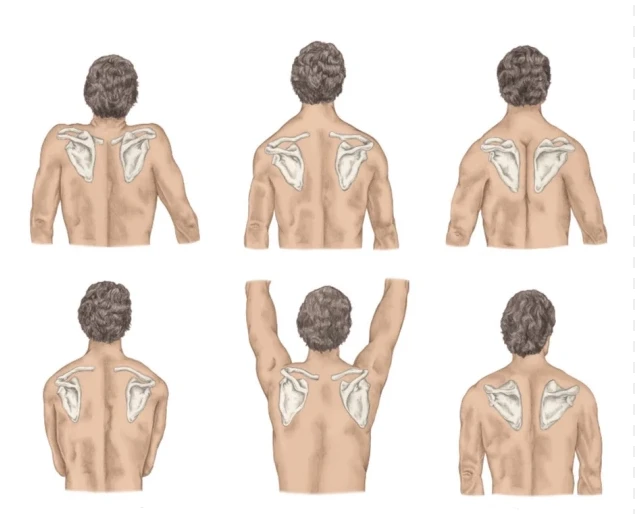</figure>

The scapula rests on the posterior rib cage and is connected to the axial skeleton primarily through the clavicular system. This arrangement allows it to move dynamically through elevation, rotation, protraction, and retraction so the glenohumeral joint remains properly aligned. Although the glenohumeral joint is a ball-and-socket joint, its range of motion depends heavily on coordinated scapular movement. When the scapula does not move effectively through the required planes, the humeral head may become poorly centered, increasing mechanical stress and contributing to impingement of the labrum or rotator cuff.

<figure>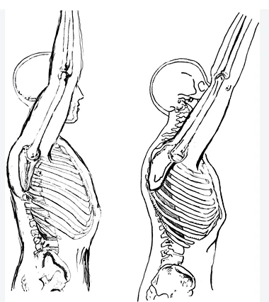</figure>

This image illustrates the consequences of inadequate scapular movement. Because the glenohumeral joint has a limited range of motion, the remaining shoulder motion must be supported by coordinated scapular retraction and rotation. In this individual, the scapula is unable to contribute effectively to that movement, so the available range of motion is restricted and the glenohumeral joint cannot maintain optimal alignment throughout the motion.

<h2>Equipment needed</h2>

<ul><li>Soft, thick rope with a pre-tied loop at one end.</li><li>Light hand weight (3–10 lb maximum).</li><li>Note: Perform this over a shirt rather than bare skin to prevent skin drag and ensure firm, comfortable tension.</li></ul>

<h2>Step 1: Set up the rope anchor</h2>

<figure>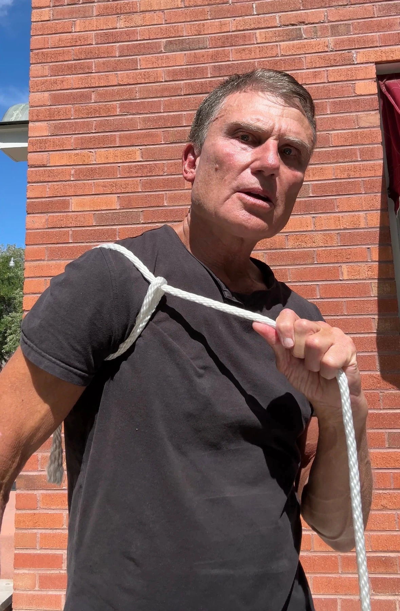</figure>

<ol>

<li>Initial Loop Placement: Slide the loop of the rope over the target arm and seat it all the way at the top of the shoulder joint, tight against the base of the neck.</li>

</ol>

<figure>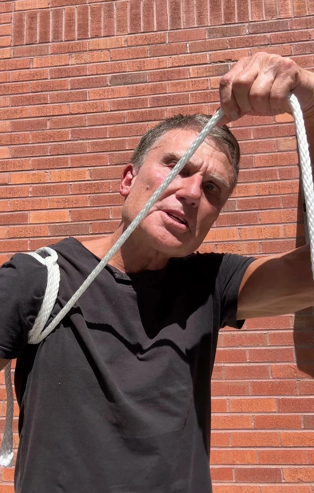</figure>

<ol><li>Layering the Wrap: Begin wrapping the rope firmly around the shoulder joint.<ul><li>Make 10 complete wraps, pulling snug on each pass.</li><li>Progress each wrap progressively</li></ul></li></ol>

<figure>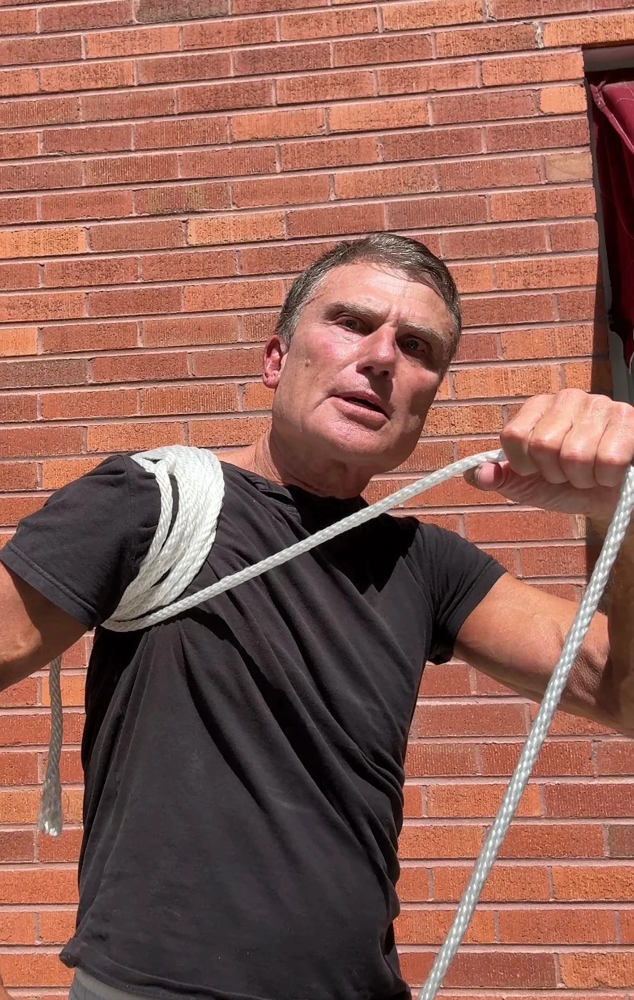</figure>

<ol><li>Layering the Wrap: Begin wrapping the rope firmly around the shoulder joint.<ul><li>Make 10 complete wraps, pulling snug on each pass.</li><li>Progress each wrap progressively</li></ul></li></ol>

<figure></figure>

Cross-Body Lock: Bring the remainder of the rope across your back and loop/anchor it securely using the opposite hand/arm to maintain tension.

<h2>Step 2: Standing retraction mobilization (gait position)</h2>

<figure>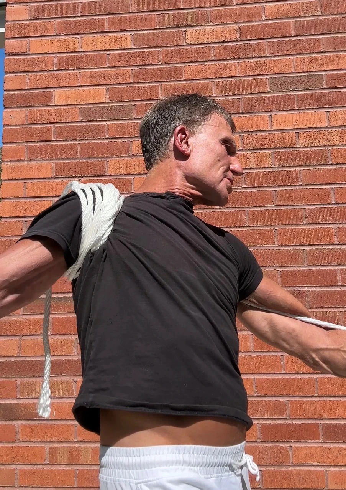</figure>

Purpose: Mobilize the scapula into full retraction and open the anterior pectoral region.

<ol>

<li>Stance Setup: If wrapping the left shoulder, step forward into a stride with the left leg.</li>

</ol>

<figure>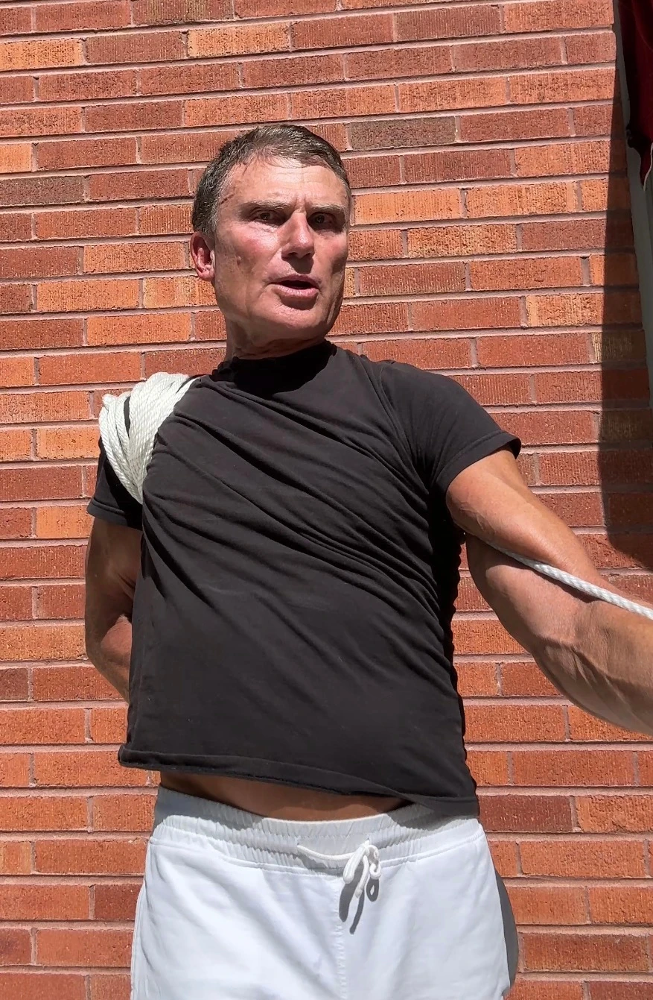</figure>

2: Oppositional Reach: Reach forward with your right arm while slightly rotating your head and leaning gently to the right.

<figure>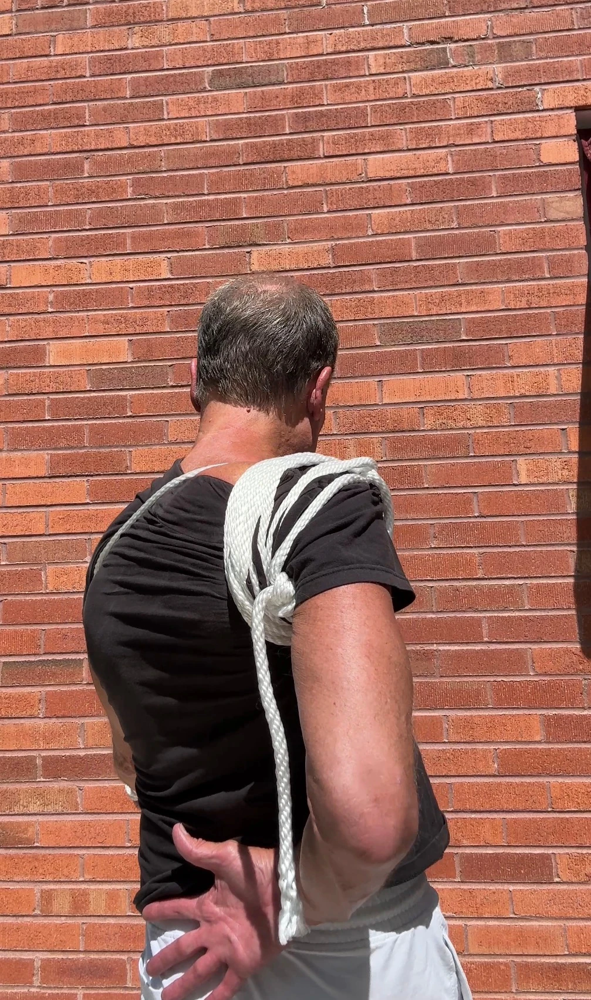</figure>

3: Scapular Pull: Maintain firm backward tension on the wrapped shoulder, actively driving the scapula into retraction.

Take a deep Breath also

4: Sensation: You should feel a deep, clean stretch across the anterior pectoral region.

Precaution: There should be zero anterior joint pinching. If sharp compression or pinching occurs, stop, re-wrap closer toward the neck, and adjust your angle.

<h2>Step 3: End-range strengthening exercises</h2>

<figure>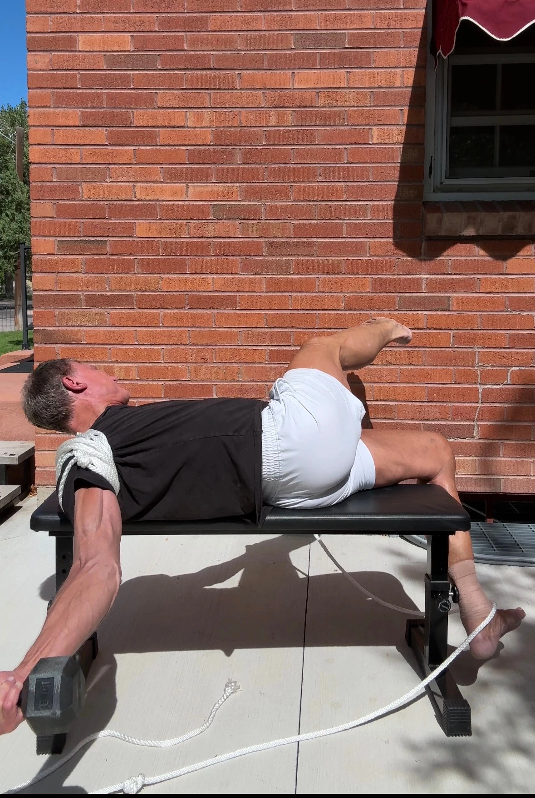</figure>

<h2>Exercise A: Side-lying end-range retraction and extension</h2>

<ol>

<li>Lie on your unaffected side.</li>

<li>Use the bottom arm to help maintain tension on the wrap and keep the shoulder packed back.</li>

<li>Hold the light weight in the top (wrapped) arm.</li>

</ol>

<figure>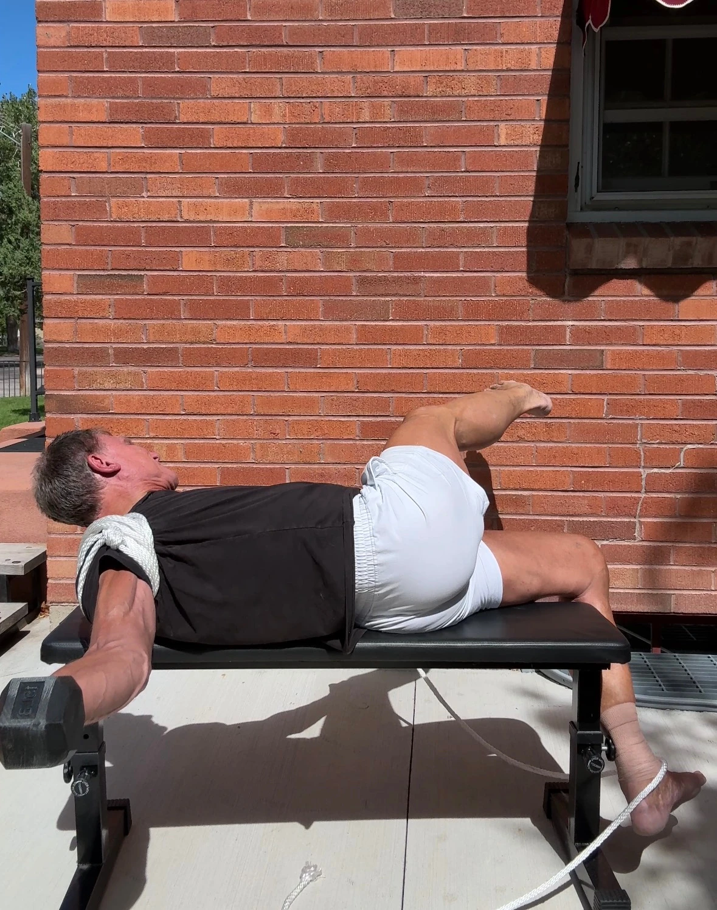</figure>

<ol>

<li>Move into end-range extension/retraction, working in a small, controlled terminal arc.</li>

<li>Allow controlled movement between the scapula and glenohumeral joint while ensuring no pinching or impingement occurs at the end of the range.</li>

<li>Perform 10 to 30 Reps 3 sets</li>

</ol>

<figure>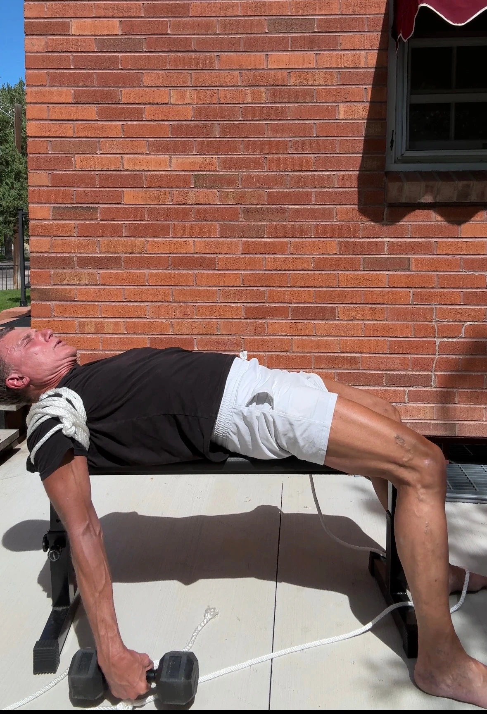</figure>

<ol>

<li>Lie flat on your back with the shoulder wrapped and anchored.</li>

<li>Hold the light weight in the hand of the wrapped arm.</li>

<li>Bring the arm toward end-range flexion.</li>

<li>Work strictly within the final 20-degree terminal arc of motion with slow, controlled pulses.</li>

</ol>

<figure>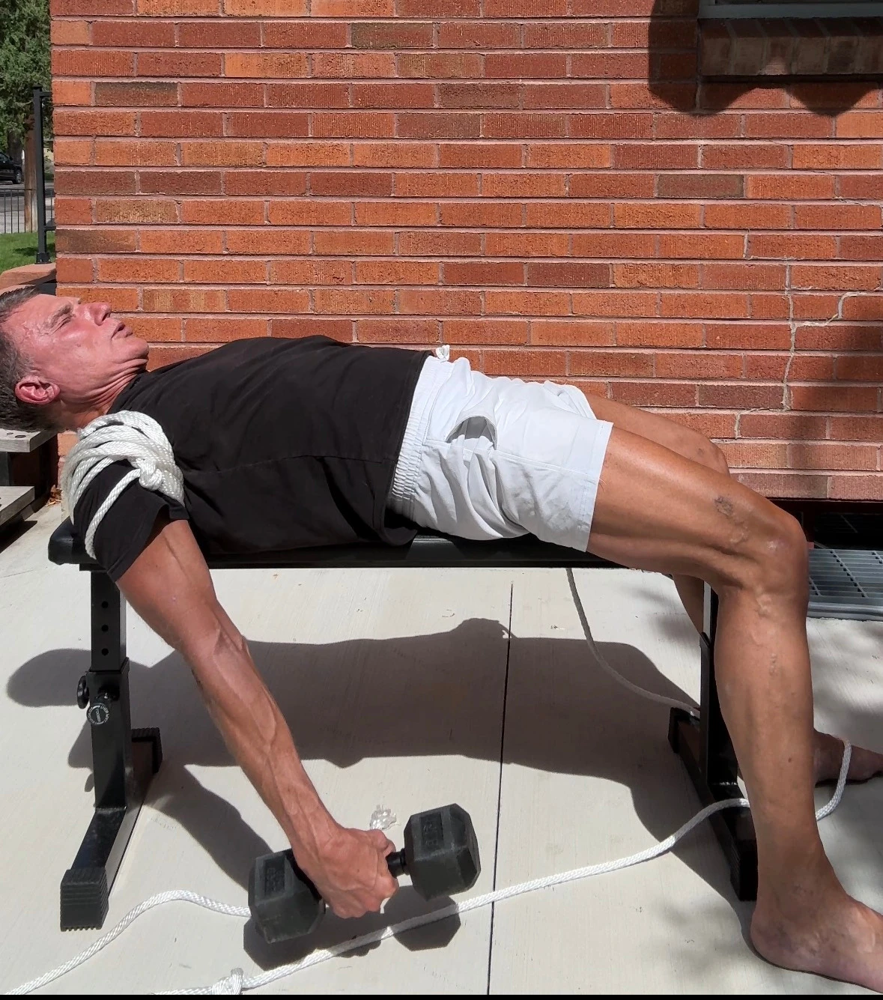</figure>

<ol>

<li>Work strictly within the final 20-degree terminal arc of motion with slow, controlled pulses.</li>

<li>Focus on active neuromuscular stabilization at the absolute barrier while the wrap protects the glenohumeral joint from over-shearing.</li>

<li>Perform 3 sets of 10 to 15 reps</li>

</ol>

