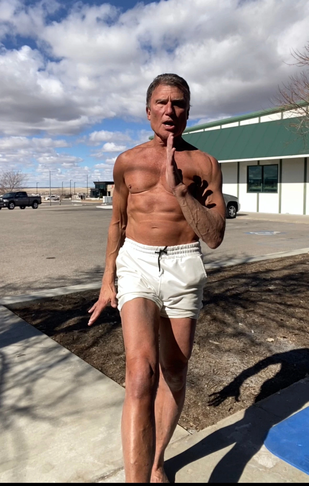
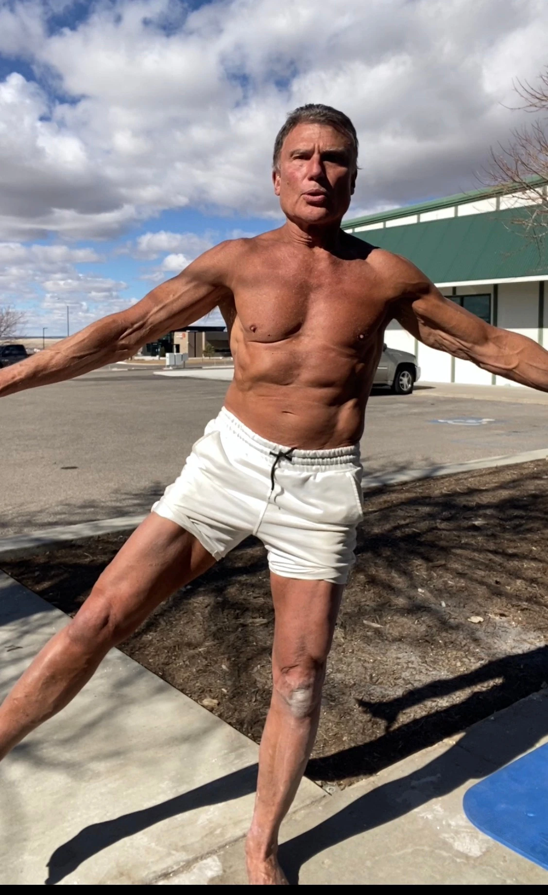
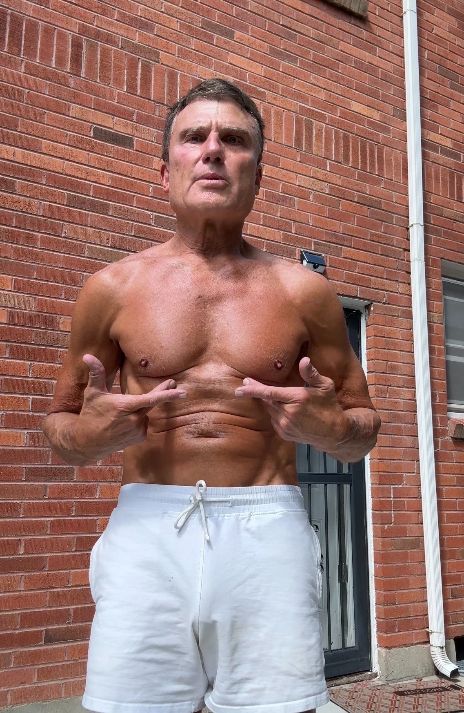
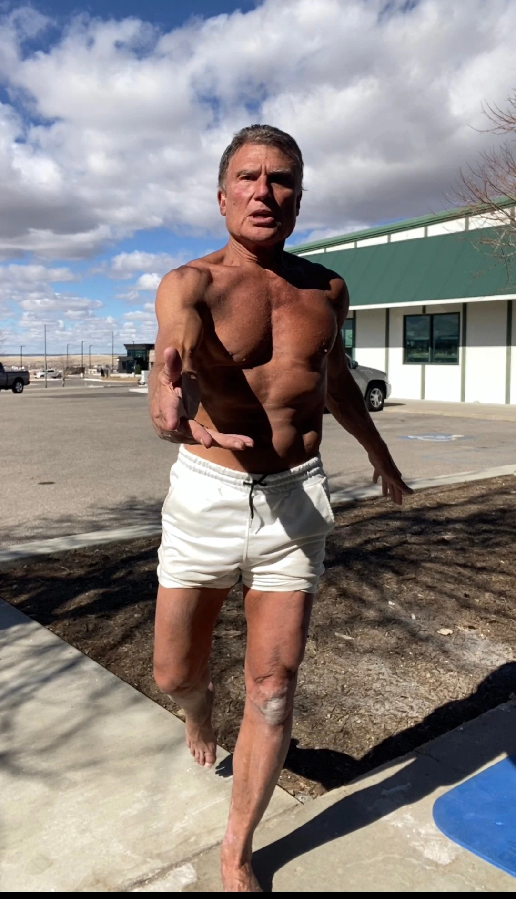
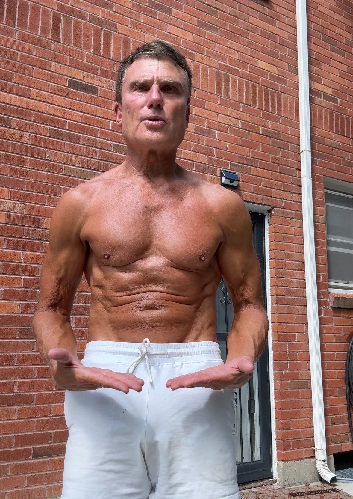

This exercise combines balance control, expansion during gait, and diaphragmatic breathing. It&#x27;s an extremely centering exercise when done slowly and deliberately.

The best way to do this exercise is barefoot in sunshine. On either ground or cement.

<h2>Position 1</h2>

First, balance on one leg and stay centered. Place one arm fully backward and the other fully forward, with your leg extending as far opposite same side arm as possible. Move smoothly. Center yourself without using momentum, and breathe with your diaphragm.

<figure></figure>

<figure></figure>

Refer to the. Diaphragm breathing exercise and check your breathing before you start.

<h2>Position 2</h2>

Moving slowly outward, expanding laterally. While using your diaphragm to breathe and maintaining a very centered core. And stop at this second position for several seconds.Move slowly outward, expanding laterally, while using your diaphragm to breathe and maintaining a centered core. Hold this second position for several seconds.

<figure></figure>

<figure></figure>

Remember, the diaphragm is the muscle you want to use to pull your air inward.

<h2>Position 3</h2>

This position is the opposite of the first: extend the other arm forward and the original arm backward, creating two circles that move in opposite directions. Your arms and legs continue moving in opposing circular patterns. From this final position, swing your leg forward like a pendulum while moving your arm backward, then return to position one.

<figure></figure>

<figure></figure>

You always want to connect your diaphragm. To your movements.

