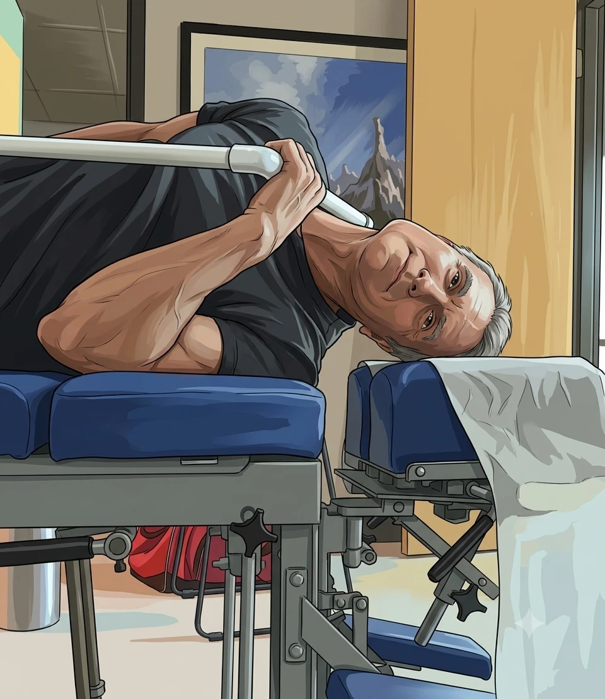
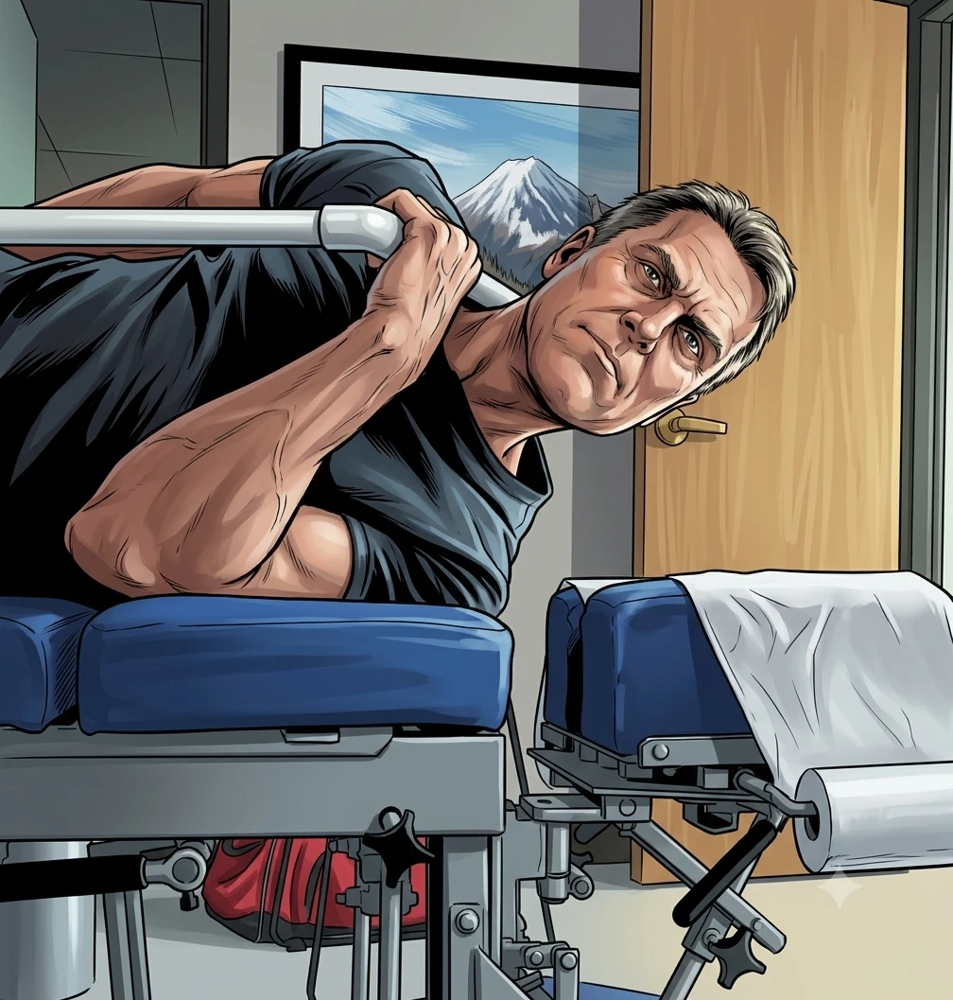
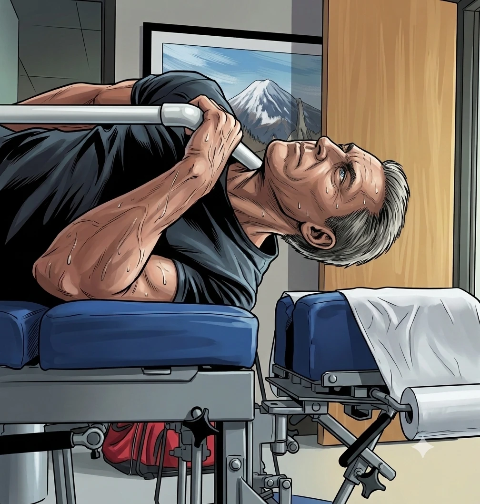
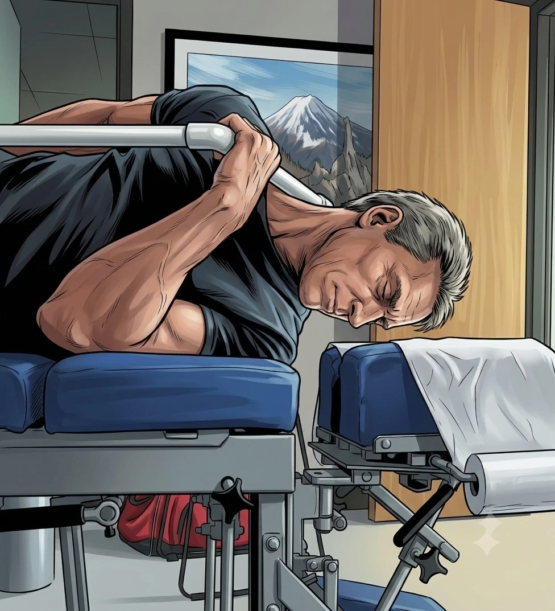

<h2>1. Neck lateral flexion</h2>

Perform this 10 times. Apply strong, direct downward pressure.

It is both an exercise and a stretch so you want to give the most out of it really get the extension going down and the exercise going up

2sets of 10 reps if possible

<figure></figure>

<figure></figure>

<h2>2. Neck rotation</h2>

Perform this 10 times on each side.

Lift your head halfway and then pull coddle on the neck flosser and rotate your head up and down to the end range in both directions 10 times and do two sets

<figure></figure>

<figure></figure>

